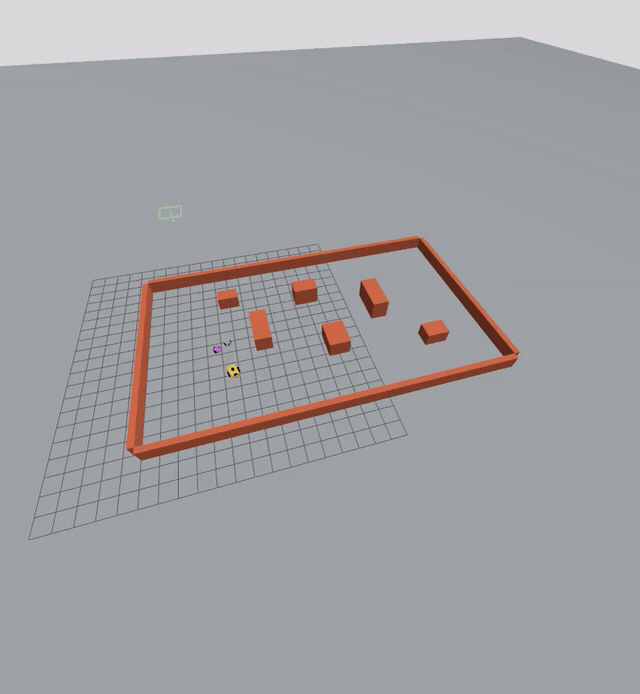

## Multi-Robot Navigation in ROS 2 and Gazebo

### Simulation Demonstration

The following animation demonstrates multi-robot navigation in the Gazebo simulation environment.




The Gazebo version now has a larger primary, obstacles, primary-only lidar/camera, ROS 2 communication, and online ANN/Transformer DQN follower control. See [GAZEBO.md](GAZEBO.md) for the current architecture, map, protocol, and limitations.

Launch in Gazebo Harmonic with ROS 2 Jazzy installed:

```bash
bash Multi_ROBOTS/launch/launch_gazebo.sh
```

The launcher opens Gazebo, spawns a gold leader and blue/purple followers, bridges velocity commands and odometry, and runs online Transformer DQN follower control at 10 Hz. Close Gazebo or press Ctrl+C in the launcher terminal to stop. Logs are written under `Multi_ROBOTS/` to `gazebo.log`, `bridge.log`, and `controller.log`. `gazebo_world.py` generates the self-contained `formation.sdf`; no model downloads are required. The launcher uses Gazebo partition `rl_three_robot_formation` and ROS domain 47 to isolate its traffic. The Gazebo controller learns its own neural expert weights online; the standalone Python demo below uses the original tabular policy.

One primary robot follows a smooth route; two differential-drive followers learn to track positions 1.5 m behind it and 0.9 m to either side. Python 3.10+ is sufficient. The live display also requires Tkinter (often supplied by the OS `python3-tk` package).

```bash
python3 Multi_ROBOTS/scripts/robot_formation.py
```

Train without opening a window:

```bash
python3 Multi_ROBOTS/scripts/robot_formation.py --headless --episodes 2500
python3 Multi_ROBOTS/scripts/robot_formation.py --load
```

The saved `policy.json` contains a shared tabular Q-learning policy. Each follower observes quantized distance and bearing to its formation target, heading alignment, and nearby-robot proximity. Nine actions combine three forward speeds with three turn rates. Rewards encourage progress and accurate formation, and penalize proximity. Learning uses epsilon-greedy exploration, learning rate 0.15, and discount 0.96. The leader uses a predefined controller; reinforcement learning controls both followers.

Evaluation prints mean formation error and the number of steps with robot separation below 0.55 m. Training is approximate and does not guarantee collision avoidance. This is a software simulation with optional Gazebo/ROS integration. Real hardware needs localization, communications, motor interfaces, and an independent safety controller.

Project layout:

```text
Multi_ROBOTS/
├── scripts/  # Controllers, world/map generation, and support modules
├── worlds/   # formation.sdf
├── config/   # policy.json and arena.yaml
├── maps/     # arena.pgm and arena.json
├── models/   # Follower Transformer checkpoints
├── launch/   # launch_gazebo.sh
└── tests/    # System and pose recovery tests
```

The launcher uses the workspace-root `.venv`. Map metadata in `config/arena.yaml`
references `../maps/arena.pgm`. Generated worlds, maps, policies, and checkpoints
use paths relative to the project, independent of the calling directory.
